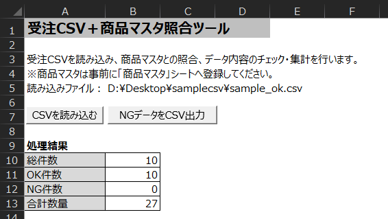
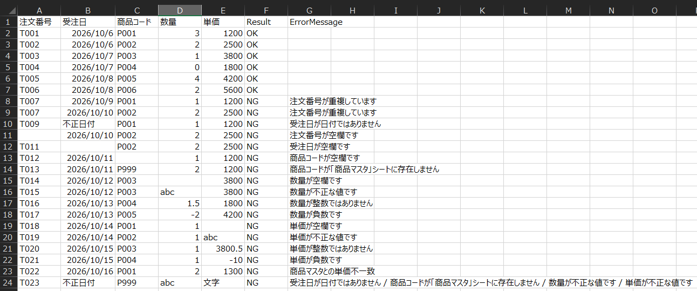
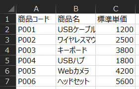

# 受注CSV＋商品マスタ照合ツール

Excel VBAで作成した、受注CSVのデータチェック・商品マスタ照合・集計を行うツールです。

受注CSVファイルを読み込み、入力内容のチェック、商品マスタとの照合、OK／NG判定、エラー内容の表示、数量集計、NGデータのCSV出力を行います。

## 想定する利用シーン

受注CSVと商品マスタを照合し、入力内容のチェック、単価の確認、集計、エラー内容の確認を行う定型業務を想定しています。

※実在する業務システムを再現したものではなく、Excel VBAによる業務データチェック・商品マスタ照合処理のサンプルとして作成しています。

## 主な機能

- CSVファイルの読み込み
- CSVの見出し・列数チェック
- 必須項目の空欄チェック
- 注文番号の重複チェック
- 受注日の日付チェック
- 数量・単価の数値・整数・負数チェック
- 商品コードと商品マスタの照合
- 商品マスタの標準単価と受注CSVの単価の照合
- 各行のOK／NG判定
- エラー内容の表示
- 総件数・OK件数・NG件数の表示
- 数量の合計
- NGデータのみをCSVファイルとして出力

## 想定するCSV形式

以下の5列を持つ受注CSVファイルを読み込みます。

| 列 | 項目名 | 内容 |
|---|---|---|
| A | 注文番号 | 注文を識別する番号 |
| B | 受注日 | 注文を受け付けた日付 |
| C | 商品コード | 商品を識別するコード |
| D | 数量 | 注文数量 |
| E | 単価 | 商品の単価 |

見出しは以下の順番である必要があります。

`注文番号,受注日,商品コード,数量,単価`

サンプル：

```csv
注文番号,受注日,商品コード,数量,単価
T001,2026/10/06,P001,3,1200
T002,2026/10/06,P002,2,2500
T003,2026/10/07,P003,1,3800
```

### 商品マスタ

商品マスタは、以下の3列で構成します。

| 列 | 項目名 | 内容 |
|---|---|---|
| A | 商品コード | 商品を識別するコード |
| B | 商品名 | 商品の名称 |
| C | 標準単価 | 商品の基準となる単価 |

サンプル：

| 商品コード | 商品名 | 標準単価 |
|---|---|---:|
| P001 | USBケーブル | 1200 |
| P002 | ワイヤレスマウス | 2500 |
| P003 | キーボード | 3800 |

商品マスタは、あらかじめ「商品マスタ」シートへ登録しておく必要があります。

## チェック内容

各行について以下のチェックを行います。

### 注文番号
- 空欄ではないこと
- CSV内で重複していないこと

### 受注日
- 空欄ではないこと
- 日付として認識できること

### 商品コード
- 空欄ではないこと
- 「商品マスタ」シートに存在すること

### 数量
- 空欄ではないこと
- 数値であること
- 整数であること
- 負の値ではないこと

### 単価
- 空欄ではないこと
- 数値であること
- 整数であること
- 負の値ではないこと
- 商品マスタの標準単価と一致していること

## チェック結果

「データ」シートの以下の列に表示します。

| 列 | 項目 |
|---|---|
| F | Result |
| G | ErrorMessage |

F列Resultに、問題がない行はOK、問題がある行はNGと表示します。

G列ErrorMessageに、エラーの内容を表記します。

複数のエラーがある場合は、各エラーメッセージをまとめて表示します。

例：

`受注日が日付ではありません / 商品コードが「商品マスタ」シートに存在しません / 数量が不正な値です`

## 集計

CSVの読み込み後、「操作」シートに以下を表示します。

- 総件数
- OK件数
- NG件数
- 合計数量

NGデータが1件でも存在する場合、合計数量は「集計不可」と表示します。

すべてのデータがOKの場合は、数量の合計を表示します。

例：

| 項目 | 件数・数量 |
|---|---:|
| 総件数 | 10 |
| OK件数 | 10 |
| NG件数 | 0 |
| 合計数量 | 27 |

## NGデータのCSV出力

「NGデータをCSV出力」ボタンを押すと、ResultがNGの行だけをCSVファイルとして出力できます。

NGデータが存在しない場合は、CSV出力を行いません。

出力されるCSVには以下の7列が含まれます。

`注文番号,受注日,商品コード,数量,単価,Result,ErrorMessage`

## 使い方

1. `受注CSV＋商品マスタ照合ツール.xlsm` を開きます。
2. マクロを有効にします。
3. 「商品マスタ」シートに商品マスタのデータを登録します。
4. 「操作」シートの「CSVを読み込む」ボタンを押します。
5. 対象の受注CSVファイルを選択します。
6. 「データ」シートで各行のチェック結果とエラー内容を確認します。
7. 「操作」シートで総件数・OK件数・NG件数・合計数量を確認できます。
8. NGデータがある場合は、「NGデータをCSV出力」ボタンからNG行だけをCSVとして保存できます。

## スクリーンショット

### 操作画面



CSVを読み込み、総件数・OK件数・NG件数・合計数量を確認できます。

※正常データを読み込んだ場合の例です。

### データチェック結果



各行のチェック結果、商品マスタとの照合結果、エラー内容を確認できます。

※異常データを含むCSVを読み込んだ場合の例です。

### 商品マスタ



受注CSVとの照合に使用する商品コード・商品名・標準単価を登録します。

## サンプルCSV

`sample` フォルダに以下のサンプルを用意しています。

### 受注CSV_動作確認_正常.csv

- すべて正常なデータ
- 商品マスタとの照合確認用
- 件数・合計数量の集計確認用

総件数10件、OK件数10件、NG件数0件、合計数量27となるデータです。

### 受注CSV_動作確認_異常混在.csv

- 必須項目の空欄
- 注文番号の重複
- 受注日の不正値
- 商品マスタに存在しない商品コード
- 数量・単価の非数値・小数・負数
- 商品マスタとの単価不一致
- 複数エラー

などを含む、入力チェック・商品マスタ照合・NGデータ出力確認用のデータです。

総件数23件、OK件数6件、NG件数17件となるデータです。

### 商品マスタ_練習用.csv

商品コード・商品名・標準単価を含む、照合確認用のサンプルデータです。

「商品マスタ」シートへ貼り付けて使用します。

## ファイル構成

```text
OrderMasterChecker/
├─ 受注CSV＋商品マスタ照合ツール.xlsm
├─ src/
│  └─ Module1.bas
├─ sample/
│  ├─ 受注CSV_動作確認_正常.csv
│  ├─ 受注CSV_動作確認_異常混在.csv
│  └─ 商品マスタ_練習用.csv
├─ images/
│  ├─ operation.png
│  ├─ data.png
│  └─ master.png
└─ README.md
```

## 動作環境

- Microsoft Excel 2019
- VBA

## 補足

本ツールでは、`Workbooks.Open` を使用してCSVファイルを読み込んでいます。

そのため、Excelによるデータ形式の自動判定によって、数値のみで構成されたコードの先頭の0が削除される場合があります。

例：`0001` → `1`

サンプルでは、コードに`A001`や`P001`のような英数字を使用しているため、この変換は発生しません。